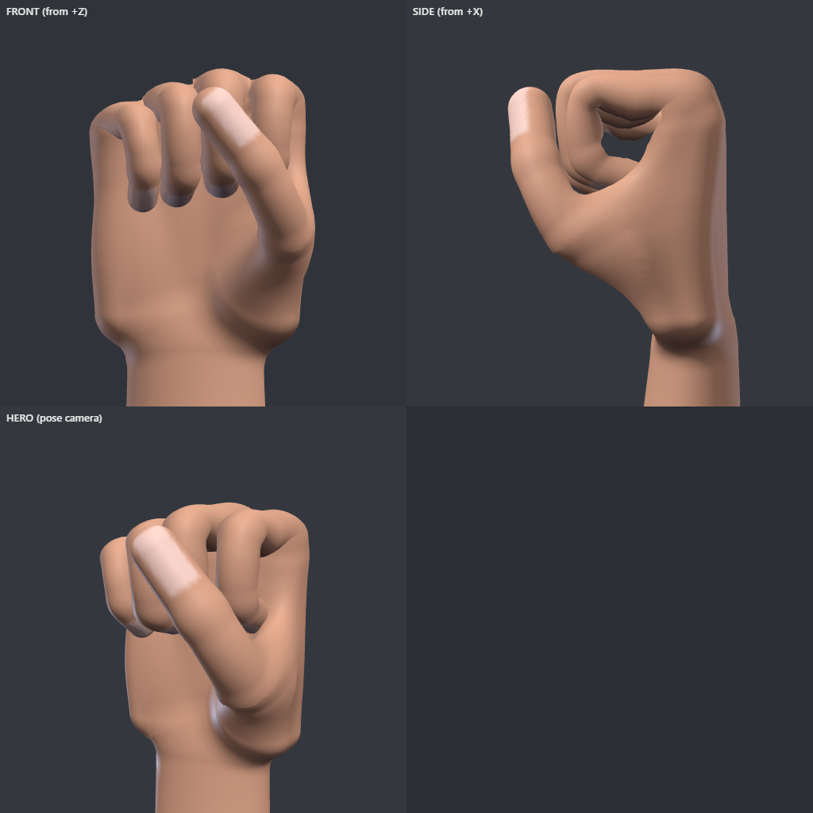

# 3D Accurate Hands (working name: Handkit)

An anatomically constrained, agent-drivable 3D hand and forearm rig for code-made video. One Rust core runs natively in fframes and as WebAssembly in HyperFrames and Remotion. AI agents pose it in joint angles, check it with numbers and small renders, and animate it with natural, deterministic motion.

Design doc: https://claude.ai/artifact/MxBq9Ef5StLhakD7BpCRBa



## Layout

- `crates/handkit-core/`: the rig, limits, contacts, the goal solver and the gesture library (`gestures/`).
- `crates/handkit-cli/`: the `handkit` command. `docs/POSE_SPEC.md` is its agent-facing spec (`handkit explain`).
- `crates/handkit-mesh/`: the procedural hand: a signed distance field built from the rig, meshed, skinned to the rig's 17 joints, with 14 corrective shapes for bent joints, written as glTF.
- `crates/handkit-fframes/`: hands in fframes 3D scenes (`HandModel`, `Hand::pose`).
- `clips/`: example clips (motion: keyed poses over time; `handkit explain clips`).
- `starters/fframes-clip/`: an fframes video that plays a clip; copy it for a video.
- `crates/handkit-wasm/` and `packages/handkit-three/`: the core as WebAssembly (`core.js`) and the three.js adapter (`handRig`).
- `tools/preview/`: the headless three.js renderer behind `handkit render`.
- `tools/golden/`: renders poses with fframes and three.js and compares them (the M3 gate).
- `tools/motion/compare.py`: a reference video and a recreation side by side (the M4 gate).
- `bench/`: agent benchmark runs (`gestures/`), golden results (`golden/`) and reference recreations (`motion/`).
- `experiments/joint-angles/`: the first experiment, a JavaScript capsule rig and three agents' attempts at 7 gestures.
- `Reference videos to Animate/`: hand-choreography videos for the final test. Video files stay local; each `clean/<slug>/NOTES.md` describes its segments.

## Use

```bash
cargo build --release
handkit gesture ok > pose.json
handkit solve pose.json
handkit render pose.json --mesh
handkit check clips/demo_basics.json
handkit sheet clips/demo_basics.json -n 12 --mesh
```

`render` needs node and a Playwright Chromium (found under `%LOCALAPPDATA%/ms-playwright`, or set `HANDKIT_CHROME`); run `npm install` in `tools/preview` once. `--mesh` draws the skinned hand, generating `assets/hand_R.glb` and `hand_L.glb` on first use (about a second each; `handkit mesh` writes them anywhere).

### fframes

```rust
use handkit_fframes::{HandModel, Side, three_d::*};
let right = HandModel::generate(Side::Right);   // or HandModel::from_glb(bytes)
let hand = right.add_to(&mut scene);
hand.pose(&mut scene, &handkit_core::solve(&pose_json)?);
```

`crates/handkit-fframes/examples/render.rs` renders one pose to a PNG. fframes links FFmpeg: on Windows set `FFMPEG_DIR` and `LIBCLANG_PATH` (for example in a git-ignored `.cargo/config.toml`) and put FFmpeg's `bin` on `PATH`.

### three.js

```js
import { handRig } from '@handkit/three';
import { init, bones } from '@handkit/three/core.js';
await init();
const gltf = await new GLTFLoader().loadAsync('hand_R.glb');
handRig(gltf.scene)(JSON.parse(bones(poseText)));
```

`sh packages/handkit-three/build-wasm.sh` rebuilds the WebAssembly (needs the `wasm32-unknown-unknown` target and `wasm-bindgen-cli` 0.2.130).

### Golden gate

```bash
python tools/golden/compare.py crates/handkit-core/gestures/*.json
```

Renders each pose in both engines and fails if a silhouette's IoU drops below 0.97.
