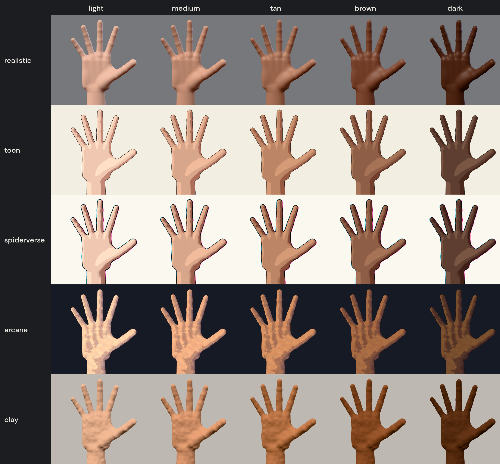
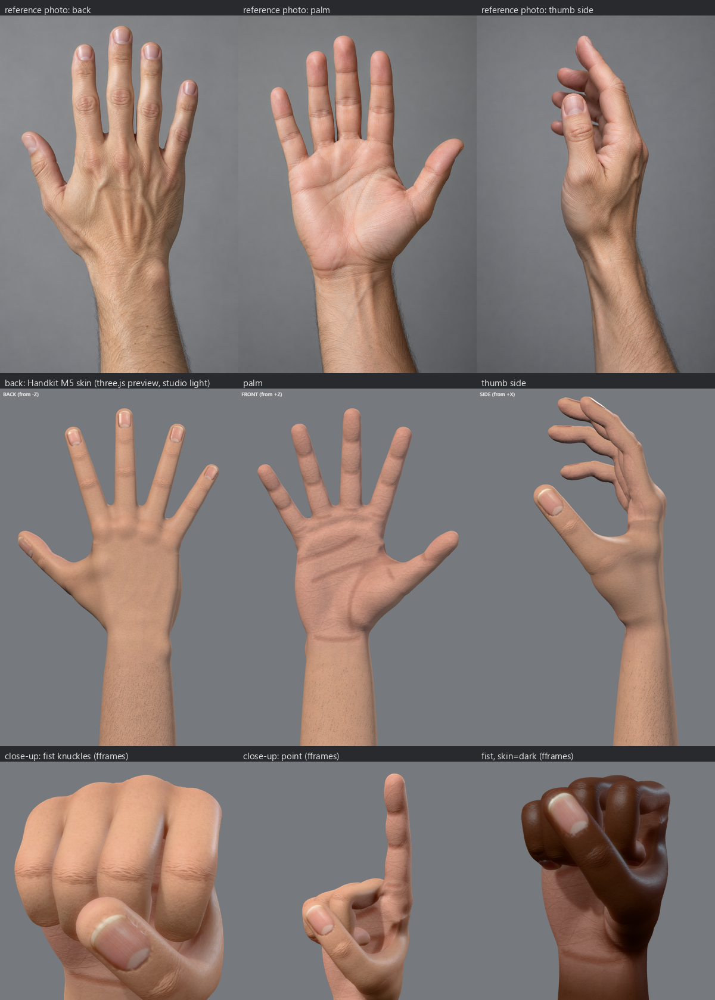

# 3D Accurate Hands (working name: Handkit)

An anatomically constrained, agent-drivable 3D hand and forearm rig for code-made video. One Rust core runs natively in fframes and as WebAssembly in HyperFrames and Remotion. AI agents pose it in joint angles, check it with numbers and small renders, and animate it with natural, deterministic motion.

Design doc: https://claude.ai/artifact/MxBq9Ef5StLhakD7BpCRBa



## Layout

- `crates/handkit-core/`: the rig, limits, contacts, the goal solver and the gesture library (`gestures/`).
- `crates/handkit-cli/`: the `handkit` command. `docs/POSE_SPEC.md` is its agent-facing spec (`handkit explain`).
- `crates/handkit-mesh/`: the procedural hand: a signed distance field built from the rig, meshed, skinned to the rig's 17 joints, with 14 corrective shapes for bent joints, UVs and baked skin maps, written as glTF.
- `crates/handkit-fframes/`: hands in fframes 3D scenes (`HandModel`, `Hand::pose`).
- `clips/`: example clips (motion: keyed poses over time; `handkit explain clips`).
- `starters/fframes-clip/`, `starters/remotion-clip/`, `starters/hyperframes-clip/`: a video that plays a clip in fframes, Remotion or HyperFrames; copy one for a video.
- `crates/handkit-wasm/` and `packages/handkit-three/`: the core as WebAssembly (`core.js`), the three.js adapter (`handRig`) and the looks in three.js (`look.js`).
- `tools/looks/`: renders a pose in every look in fframes and three.js side by side (`docs/m5-looks-threejs.png`).
- `tools/preview/`: the headless three.js renderer behind `handkit render`.
- `tools/skin/`: the skin detail tiles (`prepare_tiles.py`) and the skin review sheet (`sheet.py`).
- `tools/golden/`: renders poses with fframes and three.js and compares them (the M3 gate).
- `tools/motion/compare.py`: a reference video and a recreation side by side (the M4 gate).
- `bench/`: agent benchmark runs (`gestures/`), golden results (`golden/`) and reference recreations (`motion/`).
- `experiments/joint-angles/`: the first experiment, a JavaScript capsule rig and three agents' attempts at 7 gestures.
- `Reference videos to Animate/`: hand-choreography videos for the final test. Video files stay local; each `clean/<slug>/NOTES.md` describes its segments.

## Use

```bash
cargo build --release
handkit gesture ok > pose.json
handkit solve pose.json
handkit render pose.json --mesh
handkit check clips/demo_basics.json
handkit sheet clips/demo_basics.json -n 12 --mesh
```

`render` needs node and a Playwright Chromium (found under `%LOCALAPPDATA%/ms-playwright`, or set `HANDKIT_CHROME`); run `npm install` in `tools/preview` once. `--mesh` draws the skinned hand, generating `assets/hand_R.glb` and `hand_L.glb` on first use (a few seconds each; `handkit mesh` writes them anywhere). With `HANDKIT_STUDIO=1` it renders portrait frames under studio light, for comparing with photos: `docs/m5-shape.png` puts the hand beside the reference photos in `experiments/looks/gen/`.

### Skin



The generated hand carries UVs and baked skin maps in its glTF (a standard PBR material, so fframes and three.js both show it), about 6.5 MB per hand:

- UVs (`crates/handkit-mesh/src/uv.rs`): per-bone charts, each triangle projected along the nearest of 26 directions in its bone's frame (typically under 15% squashed), packed in one 2048 atlas with a 4-texel gutter. Vertices on chart borders are split; the copies keep their skin weights and corrective offsets.
- Maps (`crates/handkit-mesh/src/skin.rs`): every texel is computed from the bind-pose point it covers (solid texturing), so seams do not show. Colour (2048, JPEG): a medium-light tone, redder knuckles, fingertips and palm pads, a lighter palm, faint veins on the back of the hand and the inner wrist, crease and wrinkle lines, forearm hairs, and nails from a photo of a nail plate (pink bed, pale lunula, white free edge). Normal (2048, JPEG): pores, palm ridges and lines, knuckle wrinkles over the joints, softly raised veins, nail ridges. Occlusion and roughness in one image (1024, JPEG: R and G; B is the palm-skin mask, harmless there since the material is not metallic): occlusion from the shape, rougher palm and pads, glossier back and nails. Masks (1024, JPEG, linked from the material's `extras.handkit.masks`): R redness, G nail, B cavity, with no skin tone in them. fframes looks rebuild the colour map for any skin tone from these masks (`handkit_mesh::skin::tone_albedo`, once per tone and cached), so darker tones keep lighter palms and nail beds, and the stylized looks draw creases and anchor their textures (arcane brush strokes, clay fingerprints and lumps) to the skin through the same UVs.
- Skinning: the weights are smoothed over the surface between neighbouring digits (the distal joints keep theirs), so a fist or a point does not turn the skin of the knuckles and finger webs over.
- The detail comes from small tiles under `assets/skin/tiles/`, made from the generated photos by `python tools/skin/prepare_tiles.py experiments/looks/gen`.

```bash
handkit mesh -o assets/hand_R.glb --skin-dir assets/skin   # also writes the maps as files
handkit mesh -o hand_R.glb --textures 0                     # vertex colors, no maps
```

`python tools/skin/sheet.py` composes the review sheet (`docs/m5-skin.png`) from renders.

### fframes

```rust
use handkit_fframes::{HandModel, Side, three_d::*};
let right = HandModel::generate(Side::Right);   // or HandModel::from_glb(bytes)
let hand = right.add_to(&mut scene);
hand.pose(&mut scene, &handkit_core::solve(&pose_json)?);
```

`crates/handkit-fframes/examples/render.rs` renders one pose to a PNG. fframes links FFmpeg: on Windows set `FFMPEG_DIR` and `LIBCLANG_PATH` (for example in a git-ignored `.cargo/config.toml`) and put FFmpeg's `bin` on `PATH`.

### three.js

```js
import { handRig } from '@handkit/three';
import { init, bones } from '@handkit/three/core.js';
await init();
const gltf = await new GLTFLoader().loadAsync('hand_R.glb');
handRig(gltf.scene)(JSON.parse(bones(poseText)));
```

`sh packages/handkit-three/build-wasm.sh` rebuilds the WebAssembly (needs the `wasm32-unknown-unknown` target and `wasm-bindgen-cli` 0.2.130).

Looks in three.js: `HandkitLook` draws the five looks as fframes does (WebGL2, three 0.170 or later). It bakes each hand's look textures once on the GPU in its UV atlas, with the same functions as fframes (the skin tone's colour map from the mask map, crease lines from the cavity channel, arcane's brush strokes, clay's lumps and fingerprints), then renders the look's passes and post-process: lit with the studio, soft shadows and screen-space subsurface scattering (realistic, clay), or normals and data passes shaded into cel bands, ink, creases, halftone and misregistered plates (toon, spiderverse, arcane).

```js
import { init, Clip } from '@handkit/three/core.js';
import { HandkitLook } from '@handkit/three/look.js';
await init();
const look = new HandkitLook(renderer, { style: 'arcane', skin: 'tan' });   // or clip.look
await look.dress(gltf);                    // each hand, the GLTFLoader result
look.render(scene, camera);                // instead of renderer.render; transparent around the hands
look.render(scene, camera, (dt) => pose(t + dt / fps));   // with the look's motion_blur
```

`docs/m5-looks-threejs.png` puts the two engines' renders of the same poses in rows: the stylized looks agree to about one level in 255 (the same strokes, dots and lines), realistic and clay to about two, after calibrating the studio light (three lights diffuse from a prefiltered map, fframes analytically). A 1080p frame takes 4 ms (lit) to 12 ms (stylized) on the GPU, against 65 to 100 ms on the CPU in fframes; the first frame of a look bakes its textures and compiles its shaders (0.3 to 3 s). `sh tools/looks/ff_cells.sh pose.json dir` and `node tools/looks/compare.mjs pose.json dir sheet.png` (after `npm install` in `tools/looks`) redo the comparison; `python tools/looks/diff.py dir` measures it.

### Remotion

`starters/remotion-clip/`: `<HandkitClip clip={clip} look={look} />` for `@remotion/three` samples the clip at `useCurrentFrame() / fps`, poses the hands and draws them in the look. `npm install && npm run assets`, then `npx remotion render src/index.jsx HandkitDemo out/demo.mp4 --gl=angle` renders `clips/demo_basics.json` (5.2 s at 1080p in about 24 s).

### HyperFrames

`starters/hyperframes-clip/`: an HTML composition whose canvas poses the hands from `clip.bones(t)` on every `hf-seek` (seek-safe: no state between frames) and draws them in the look; the `look` variable picks one (`--variables '{"look":"toon"}'`). `npm install && npm run assets`, then `npx hyperframes@0.8.179 render --output out/demo.mp4` (5.2 s at 1080p in about 17 s).

### Golden gate

```bash
python tools/golden/compare.py crates/handkit-core/gestures/*.json
```

Renders each pose in both engines and fails if a silhouette's IoU drops below 0.97.
