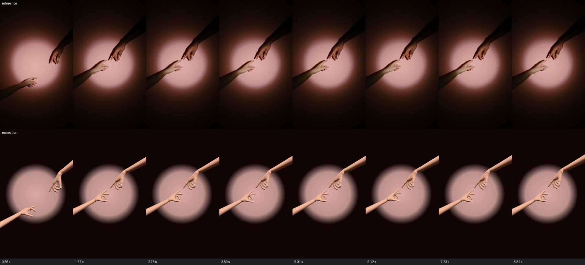
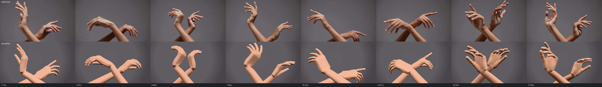

# M4 gate: reference segments recreated

Two agents (Claude Opus, one each) were given a reference segment, `docs/POSE_SPEC.md`, the CLI and
the fframes clip starter, and asked to recreate the segment as a Handkit clip rendered with
fframes. Only the output video was judged. Each worked in its own folder here; `NOTES.md` in
each has the second-by-second breakdown, the method, the final `handkit check` and every problem
the agent hit. Videos stay local (git-ignored); `python tools/motion/compare.py` rebuilds the
comparisons.

| Segment | Length | Keys | Tokens | Time | Rounds | Result |
| --- | --- | --- | --- | --- | --- | --- |
| pexels-people-touching-fingers | 8.9 s, portrait | ~30 | 251k | 18 min | ~12 | Framing, fingertip paths and timing match: tips within 1 to 6 px of the tracked reference, at most about 16 px. Hand shapes passable. |
| pexels-hands-doing-gestures | 18.2 s, landscape | 37 | 308k | 25 min | ~14 | Composition, forearm crossing, hand positions and phrase timing match. Fast palm turns arrive a little late; fingers are stiffer than the dancer's. |

## Verdict

Passed: both segments are recognisably the same motion, timed to the reference, with no
penetrations or pops. What still separates them from the footage:

- **Fingers.** Real fingers are slender, finely graded and keep moving between keys; ours are
  stiffer and sometimes hook. Mostly the procedural mesh (blocky edge-on, a sharp crease at the
  wrist under heavy extension) and keys too sparse for the fingers.
- **Forearms.** The rig ends at the elbow with a short, uniform forearm, so long reaches need
  camera tricks to keep the arm's end out of frame.

## Fixed from the agents' reports

- No way to move through a key without stopping: `"pass": true` waypoint keys (both agents
  hand-built this, from dense linear keys or overlapping moves).
- No way to aim the forearm while placing the hand: `place.forearm_toward` sets the wrist angles
  in closed form (both agents wrote their own solver).
- Starting a clip mid-move and `follow` assuming a still start: a key at a negative `t`, now
  documented.
- Wrist limits narrower than a dancer's: wrist_flex now -80 to 85, wrist_dev -35 to 35.
- `check` framing said only "a fingertip": it now names the tip, the edge and how far out, and
  flags an elbow (the forearm's end) in view.
- `check` sampled one frame more than the player renders: it now samples the same frames.
- `sample` wrote placement only as elbow and rotation: `sample --wrist` writes wrist,
  palm_facing and fingers_toward.
- No reference comparison: `tools/motion/compare.py` (rows at the same times, side-by-side MP4).

## Still open

Fingertip-at-screen-position goals, `fk --json`, marking a framing warning as intended, which
forearm is in front when two cross, a spotlight with a glow, and the mesh's proportions (M6,
realistic hand).
