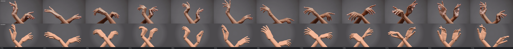
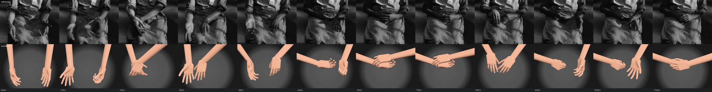

# M4 gate: reference segments recreated

Two agents (Claude Opus, one each) were given a reference segment, `docs/POSE_SPEC.md`, the CLI and
the fframes clip starter, and asked to recreate the segment as a Handkit clip rendered with
fframes. Only the output video was judged. Each worked in its own folder here; `NOTES.md` in
each has the second-by-second breakdown, the method, the final `handkit check` and every problem
the agent hit. Videos stay local (git-ignored); `python tools/motion/compare.py` rebuilds the
comparisons.

| Segment | Length | Keys | Tokens | Time | Rounds | Result |
| --- | --- | --- | --- | --- | --- | --- |
| pexels-people-touching-fingers | 8.9 s, portrait | ~30 | 251k | 18 min | ~12 | Framing, fingertip paths and timing match: tips within 1 to 6 px of the tracked reference, at most about 16 px. Hand shapes passable. |
| pexels-hands-doing-gestures | 18.2 s, landscape | 37 | 308k | 25 min | ~14 | Composition, forearm crossing, hand positions and phrase timing match. Fast palm turns arrive a little late; fingers are stiffer than the dancer's. |

## Verdict

Passed: both segments are recognisably the same motion, timed to the reference, with no
penetrations or pops. What still separates them from the footage:

- **Fingers.** Real fingers are slender, finely graded and keep moving between keys; ours are
  stiffer and sometimes hook. Mostly the procedural mesh (blocky edge-on, a sharp crease at the
  wrist under heavy extension) and keys too sparse for the fingers.
- **Forearms.** The rig ends at the elbow with a short, uniform forearm, so long reaches need
  camera tricks to keep the arm's end out of frame.

## Fixed from the agents' reports

- No way to move through a key without stopping: `"pass": true` waypoint keys (both agents
  hand-built this, from dense linear keys or overlapping moves).
- No way to aim the forearm while placing the hand: `place.forearm_toward` sets the wrist angles
  in closed form (both agents wrote their own solver).
- Starting a clip mid-move and `follow` assuming a still start: a key at a negative `t`, now
  documented.
- Wrist limits narrower than a dancer's: wrist_flex now -80 to 85, wrist_dev -35 to 35.
- `check` framing said only "a fingertip": it now names the tip, the edge and how far out, and
  flags an elbow (the forearm's end) in view.
- `check` sampled one frame more than the player renders: it now samples the same frames.
- `sample` wrote placement only as elbow and rotation: `sample --wrist` writes wrist,
  palm_facing and fingers_toward.
- No reference comparison: `tools/motion/compare.py` (rows at the same times, side-by-side MP4).

## Run 2: after the fixes

Fresh agents, same brief: the gestures segment again (blind to run 1) and a new 12 s segment from
Burrows and Roberts' film *Hands* (seated performer, 4:3, black and white, hand-over-hand
contact and fast swings).

| Segment | Length | Keys | Tokens | Time | Result |
| --- | --- | --- | --- | --- | --- |
| pexels-hands-doing-gestures-v2 | 18.2 s | 35 | 170k (run 1: 308k) | 24 min | Same quality as run 1 with 45% fewer tokens; `check` clean. Used pass keys and forearm_toward instead of building its own. |
| hands-burrows-roberts-144 | 12 s, 4:3 | 39 | 239k | 23 min | Framing, order and timing within 0.1-0.2 s; both hand-over-hand folds land. Blurred flicks read as crisp snaps; interlaced fingers read as one hand on the other. |

Fixed from run 2's reports:

- Placing a hand where it is seen (both agents in both runs wrote their own projection):
  `place.screen` [x, y] in frame fractions plus `depth`, and `elbow_screen` for the forearm.
- Fingertips jumping 20-150 mm when one hand crossed the other: the per-frame separation ran
  between the two hands and flipped fingers to the far side. It now keeps only a hand's own
  parts apart; `check` reports crossings per move with the keys either side, so the Burrows clip
  now shows 14 honest overlaps where it used to pop.
- Timing per hand inside a key; a hand a key leaves out keeps moving between its own keys.
- `solve` exits 2 when a goal is missed; `check` names the keys around pops and reports joints
  held at a limit; `sheet` follows the clip's aspect and takes `--background`; the player prints
  `--help` (it ran without output because Windows could not find FFmpeg's DLLs; they are now
  copied next to it) and `--spotlight` x is a fraction of the width.

## M6: hands kept apart

Clips now push the faster of two hands aside where their moves would cross (`"collide"`,
`handkit explain clips`). The Burrows clip, `handkit check` with collisions off and on:

| | hand-crossing penetrations | deepest | problems | pops |
|---|---|---|---|---|
| off (`"collide": false`) | 14 | 23.7 mm (right thumb through left thumb, 2.90 s) | 15 | none |
| on (default) | none | - | 2 (framing, elbow in view) | none |

The hands keep the authored layering and slide over or under each other instead of through;
in the hand-over-hand folds the push reaches 6-14 cm, so the right wrist's peak speed rises
from 0.59 to 2.02 m/s.

## Still open

- Finger waves and gesture blends across waypoint keys, for dance.
- Motion blur in the player, a sleeve or fade where the forearm ends, and the mesh's
  proportions (M5, realistic hand).
